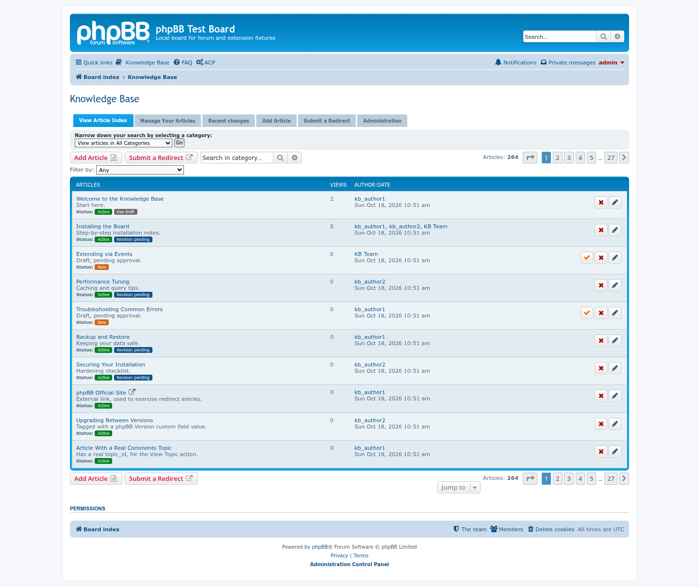
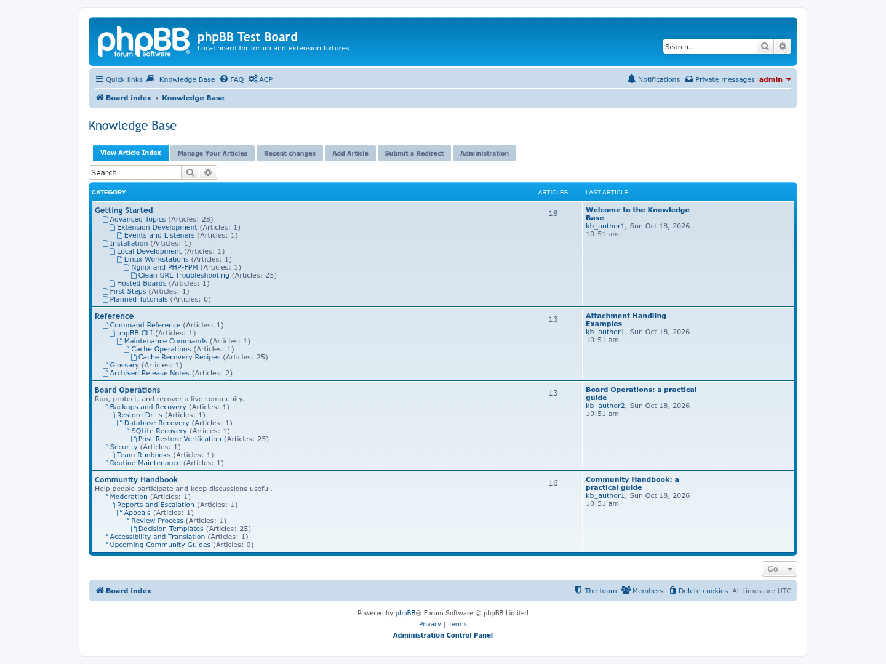
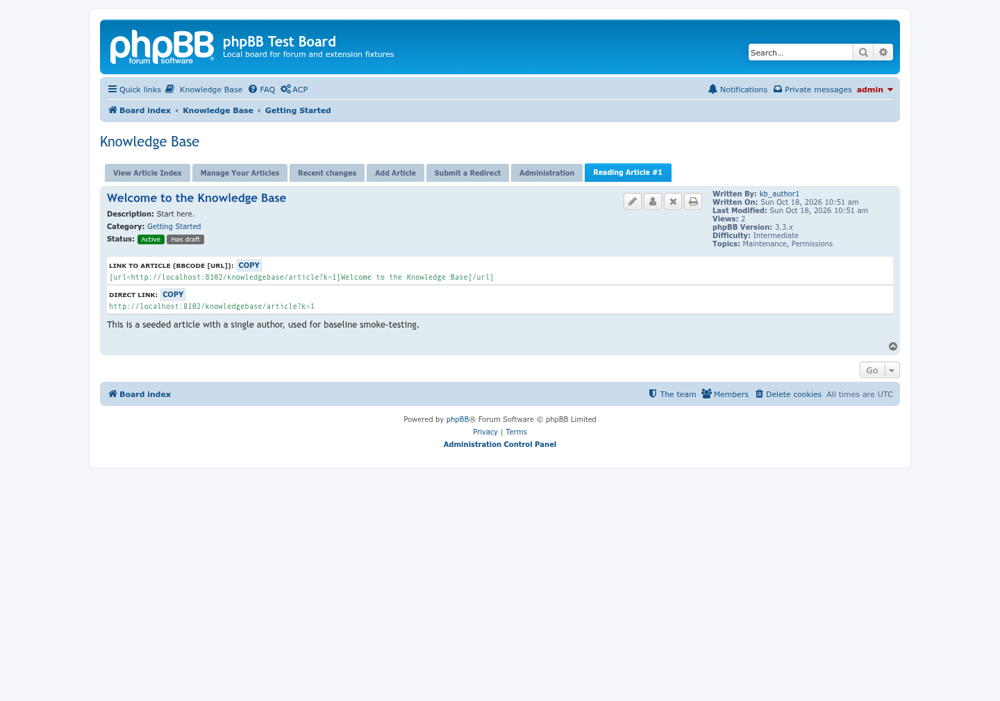
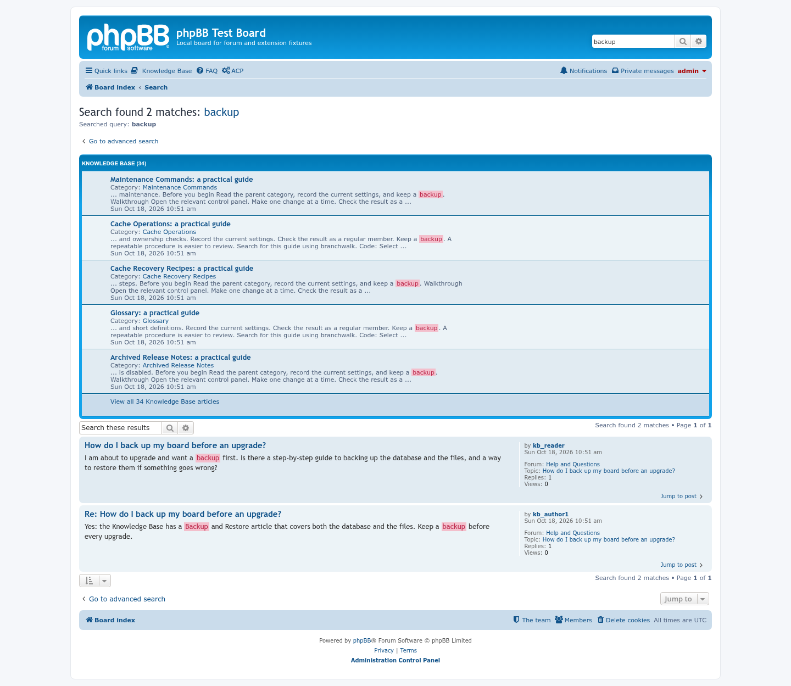

# Knowledge Base

A knowledge base for phpBB: articles organised in categories, with attachments, Markdown or BBCode text, revisions, an approval workflow, search, and its own permission system, all managed from the ACP.

## Screenshots

<table>
<tr>
<td align="center"><a href="docs/images/screenshots/01-flat-index.png"></a><br>The flat article index (the default)</td>
<td align="center"><a href="docs/images/screenshots/08-category-tree.png"></a><br>Hierarchical category browsing</td>
</tr>
<tr>
<td align="center"><a href="docs/images/screenshots/02-article.png"></a><br>An article</td>
<td align="center"><a href="docs/images/screenshots/09-board-search-kb-block.png"></a><br>Knowledge Base block in the board search</td>
</tr>
</table>

More screenshots, including the article form, the approval queue and the ACP settings: [docs/images/screenshots](docs/images/screenshots/README.md).

Primary authorship of submitted articles can be transferred to another active
member or a configured KB team using **Change author** on the article page.
Grant moderators **Can change the primary author of submitted articles** in
Knowledge Base category permissions. KB administrators already have access.
Transfers are logged and retain co-authors and submitted revisions. Private
drafts and articles with private draft edits must be submitted or discarded
before authorship can change.

Article pages show status below the category. Category lists and review queues also show status, pending revisions, and “Has draft” for authors and authorized editors. Draft contents remain private. Markdown search excerpts retain their formatting.

## Installation

1. Copy the extension to: `/ext/phpbbmodders/knowledgebase`
2. In the Administration Control Panel, navigate to: **Customise → Manage extensions**
3. Enable the **Knowledge Base** extension
4. Configure it under **Extensions → Knowledge Base**

The Knowledge Base follows each member's board style. It starts as a flat article
index (one list of every article, with a category dropdown); hierarchical category
browsing and an optional colour stylesheet (a bundled one, or your own CSS file) are
set on the same ACP page; see the [styling guide](docs/TODO/archive/styling/README.md).

A search of the board also shows the matching articles in a **Knowledge Base** block above
the forum results, with an **Also search the Knowledge Base** option in the advanced search.
Switch the block off, or set how many articles it lists, under **Extensions > Knowledge Base >
Search**.

Upgrading from the original `sheer/knowledgebase` extension? See
[Upgrading from the original](docs/upgrading-from-original.md): your data carries
over.

Attachments are stored under `store/phpbbmodders_knowledgebase/files/` in the board's own folder,
with the rest of phpBB's data, so they stay when the extension's folder is replaced to upgrade it.
The folder is made when the extension is enabled and has its own `.htaccess`. **That only works on
Apache** - nginx ignores `.htaccess` entirely, and phpBB's installation notes already ask nginx
users to block the `store/` folder. If yours does not, add an explicit deny rule for it in your server
config, e.g.:

```nginx
location ~ ^/store/ {
	deny all;
	return 403;
}
```

## Common problems

### "The Knowledge Base's upload folders ... could not be made writable automatically"

A red message at the top of **Extensions > Knowledge Base > Configuration**. The extension keeps attachments, and uploads that are still in progress, in `store/phpbbmodders_knowledgebase/files/` and its `plupload/` folder, inside phpBB's own `store/` folder. It makes them when it is enabled, and again whenever that page opens. It cannot when the web server's user is not allowed to write in `store/`, which phpBB needs on every board, or in `store/phpbbmodders_knowledgebase/` when someone else made that folder first (for example to put a custom stylesheet in it).

Give `store/` to the user your web server or PHP runs as (`www-data` on Debian and Ubuntu, `apache` on Fedora and CentOS, `nginx` on some nginx setups), from the board's root folder:

```bash
sudo chown -R www-data:www-data store
sudo chmod -R 775 store
```

Without shell access, set the `store` folder and everything in it to 775 with your FTP program (777 only if your host allows nothing else). Reload the Configuration page: the message goes away as soon as the folders can be made. Attachments that earlier versions kept in `ext/phpbbmodders/knowledgebase/files/` are moved across when the extension is updated; any that could not be moved stay in that folder and keep the old problem, so run the commands above and disable and enable the extension again.

## Automated testing

See [Testing](docs/testing.md) for local regression tests and disposable
MySQL/PostgreSQL fixtures. The current GitHub workflow runs coding and
extension validation checks, not these regression tests.

[](https://github.com/phpbbmodders/knowledgebase/actions/workflows/tests.yml)

## TODO

Ideas not yet built, practical and speculative alike: [`docs/TODO.md`](docs/TODO.md).

## Acknowledgments

Based on the original [knowledgebase](https://github.com/sutrus/knowledgebase) extension by sutrus (Zdenek Kamenik), itself building on earlier work by Sheer's [Knowledge Base](https://github.com/AlexSheer/phpbb3.2-Knowledge-Base) extension.

- Code review, bug fixes, and documentation assisted by [Claude](https://www.anthropic.com/claude).
- Code review, bug fixes, and documentation assisted by [Codex](https://openai.com/codex/).


## License

Licensed under the [GNU General Public License v2](license.txt)
