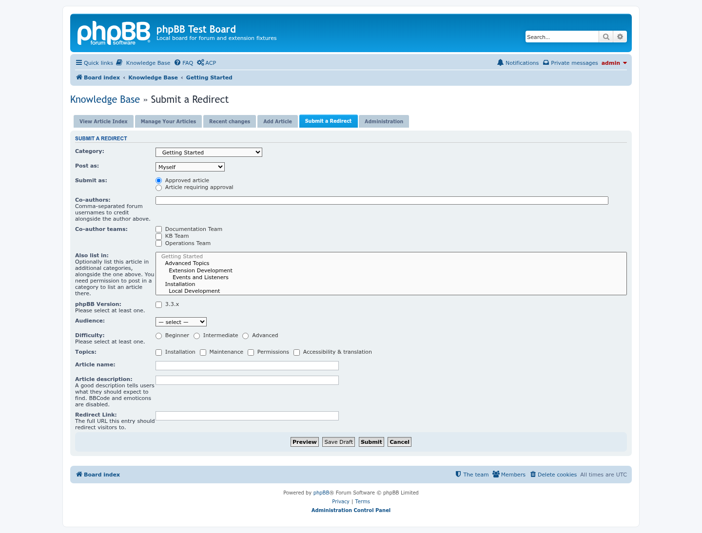
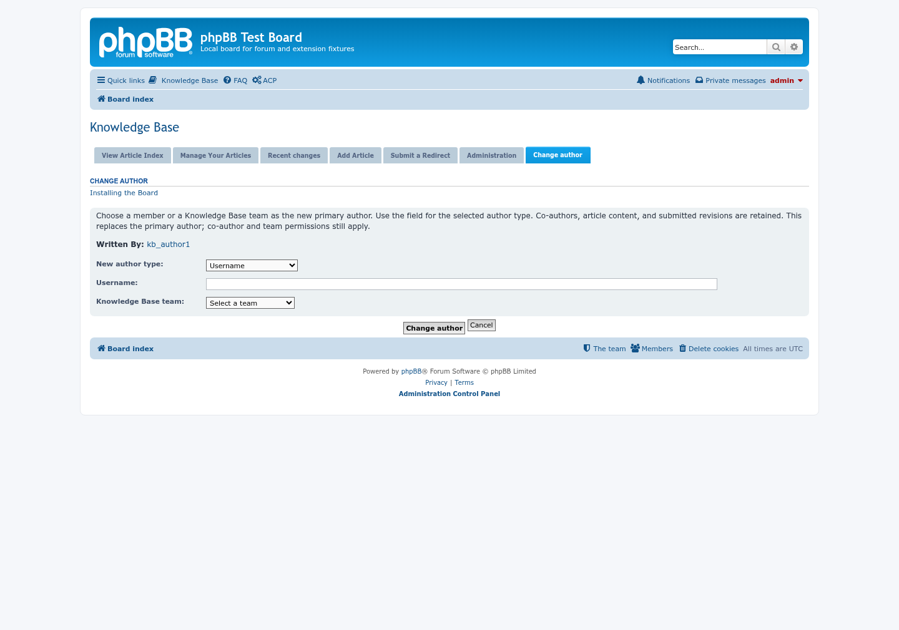
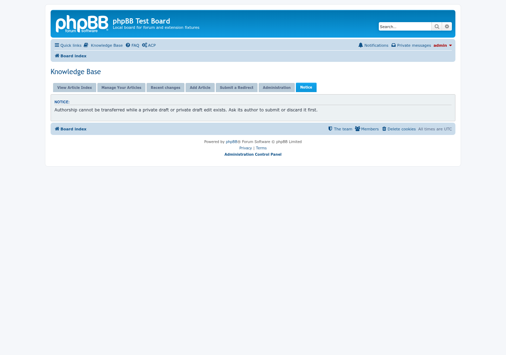

# Knowledge Base screenshots

Captured with Playwright from the real Knowledge Base checkout mounted by
seed-forum on a disposable phpBB 3.3.19 board (prosilver, SQLite). The shared
`seed-kb-fixtures.php` supplies the articles, drafts, revisions, teams and
scoped author-transfer moderator. Member pages use `kb_author1`; the other
pages use the fixture administrator.

The reusable capture script is `tests/browser/kb_screenshots.js`, run through
the Playwright skill runner with explicit `KB_TEST_URL`, `KB_TEST_BOARD_ROOT`,
`KB_ARTIFACT_DIR`, and `KB_SCREENSHOT_CONFIG_HELPER` variables. The companion
`tests/browser/kb_screenshot_config.php` temporarily switches hierarchical
browsing on for the category-tree capture and restores its previous setting.
The current fixture is the seed-forum board at `http://localhost:8102`.

The two ACP pages are taken in full, so a setting further down the page is not cut off.

## The flat article index

Every article in one list, with a dropdown to narrow it down by category.

## Hierarchical category browsing

The category tree with its subcategories, article counts and the last article of each.

## An article

The article with its status, details, a copyable link and BBCode, and the tab that reads "Reading Article #1", with the private-draft indicator visible to the administrator.

## Manage your articles

A member's own articles and drafts.

## Recent changes

The **Recent changes** tab: the live articles, newest first, with a **New** or **Updated** badge, the category, the author and when the article last changed. Under the heading are the RSS and Atom feeds of the same list. A browser or feed reader also finds them from the page header, and the ACP says which formats are offered.

## Add an article

The form for a new article.

## The approval queue

The Administration tab: new articles and revisions waiting for review, with the actions available to a moderator.

## Search

Results of a search on the Knowledge Base's own search page.

## ACP configuration

**Extensions > Knowledge Base > Configuration**, the whole page: the announcement and changelog forums, hierarchical browsing, the alternative stylesheet, the **Recent changes feed** (RSS, Atom or both), the number of articles per page, the description length and the sorting order, then the attachment settings, the review teams and the contact group.

## Knowledge Base articles in the board's search

A search in phpBB's own search for `backup`. The **Knowledge Base (4)** block sits above the forum results and lists the best matches with their category, a snippet with the word marked and a link to all of them; the forum post that asks about backups is the first of the forum results below it. Switch the block off, or set how many articles it lists, in the ACP.

## Also search the Knowledge Base

The advanced search has an **Also search the Knowledge Base** option, ticked by default.

## ACP search settings

**Extensions > Knowledge Base > Search**: under **General search settings**, whether the board search shows the Knowledge Base block and how many articles it lists, beside the results per page for the Knowledge Base's own search; then the search backend and each backend's index.

## Submit a redirect

The redirect form, with its visible Knowledge Base » Submit a Redirect heading.

## Change author

Transfer the primary author to an active member or configured KB team while retaining the pending revision.

## Private draft Notice

A blocked transfer appears in the extension's Notice tab, with the board styling and navigation intact.

## Rendered Markdown search

Markdown headings, lists and emphasis render in a shortened search excerpt rather than appearing as source syntax.

