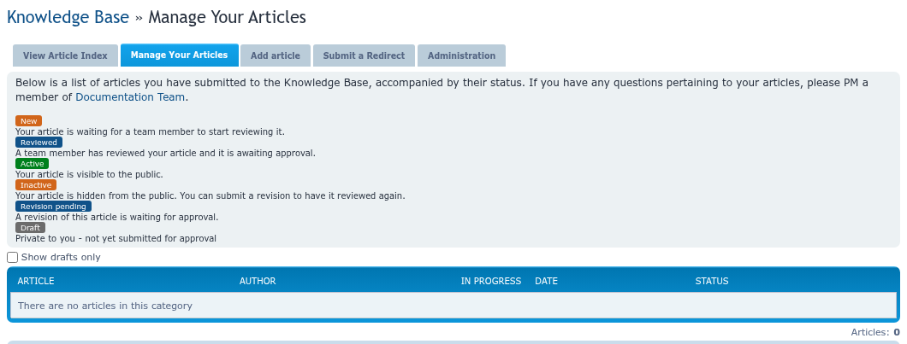
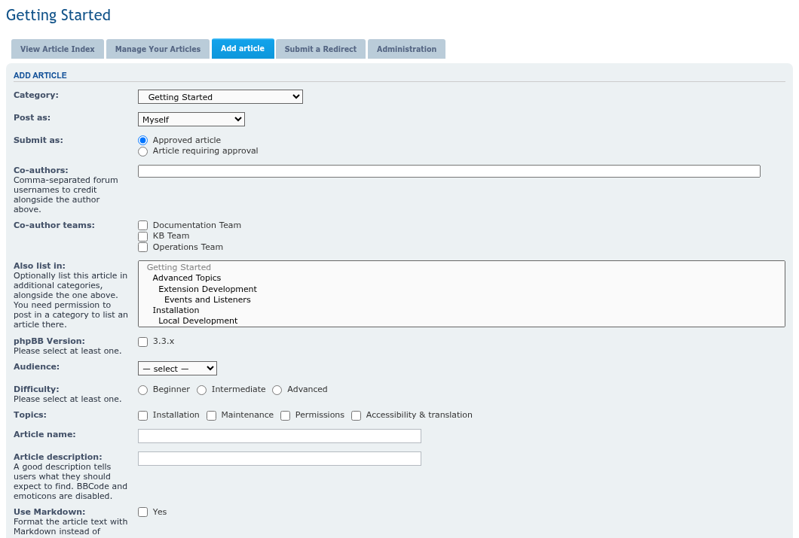
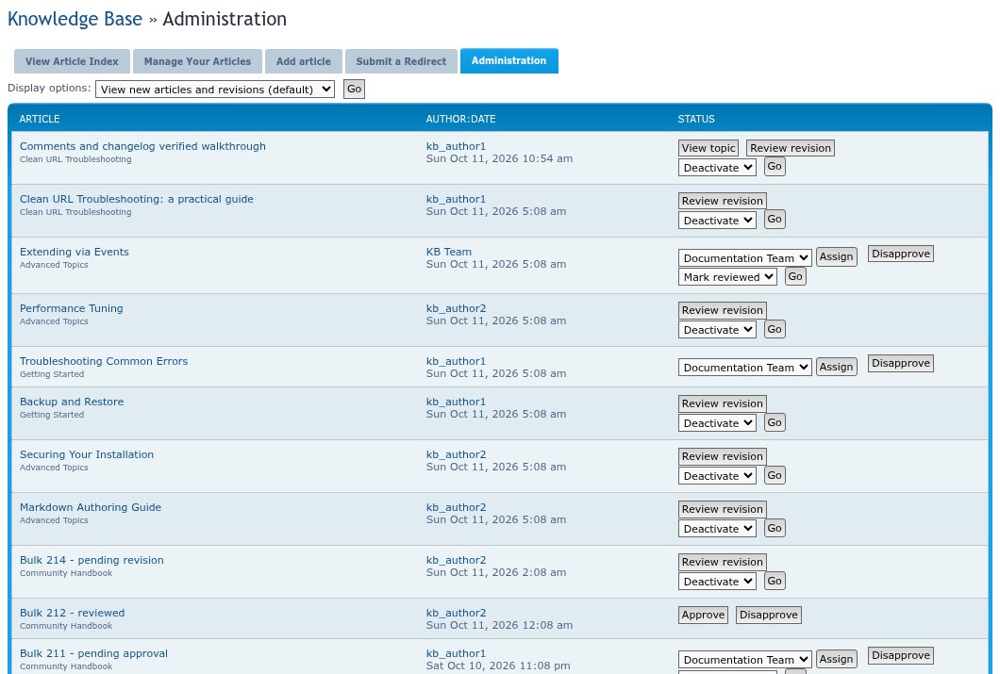
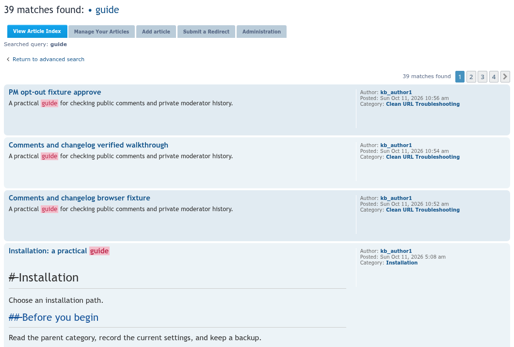
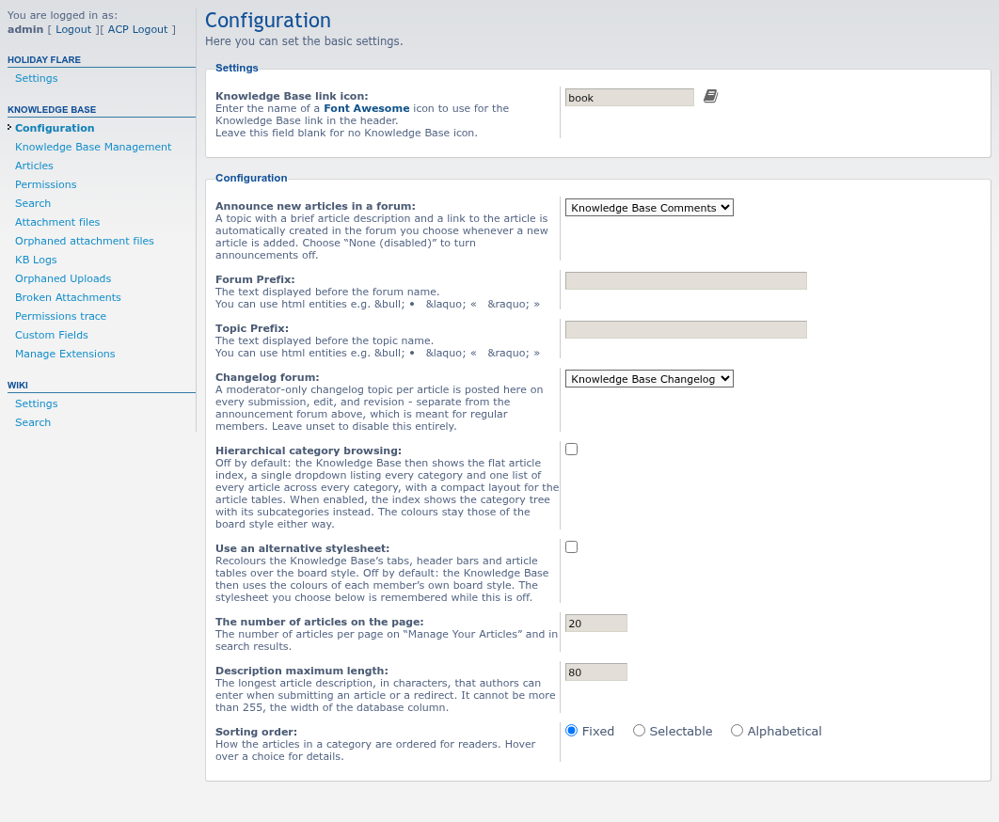

# Knowledge Base screenshots

Taken with Playwright on a throwaway phpBB 3.3.19 board (prosilver, SQLite) filled with test articles, as an administrator. The flat article index is the default; the category tree needs **Hierarchical category browsing** switched on under **Extensions > Knowledge Base > Configuration**.

## The flat article index

Every article in one list, with a dropdown to narrow it down by category.

## Hierarchical category browsing

The category tree with its subcategories, article counts and the last article of each.

## An article

The article with its status, details, a copyable link and BBCode, and the tab that reads "Reading Article #1".

## Manage your articles

A member's own articles and drafts.

## Add an article

The form for a new article.

## The approval queue

The Administration tab: new articles and revisions waiting for review, with the actions available to a moderator.

## Search

Results of a search in the Knowledge Base.

## ACP configuration

**Extensions > Knowledge Base > Configuration**, with the hierarchical browsing and alternative stylesheet settings.

