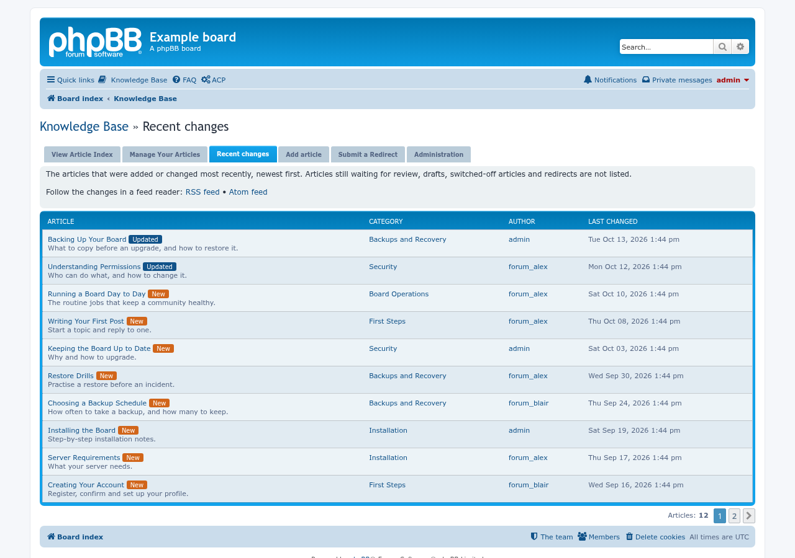
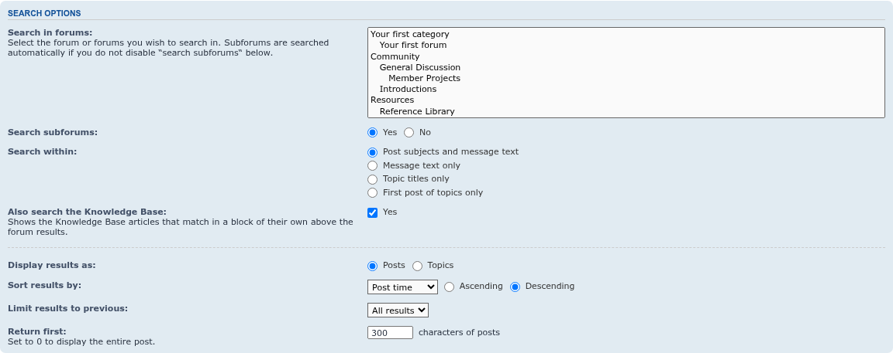
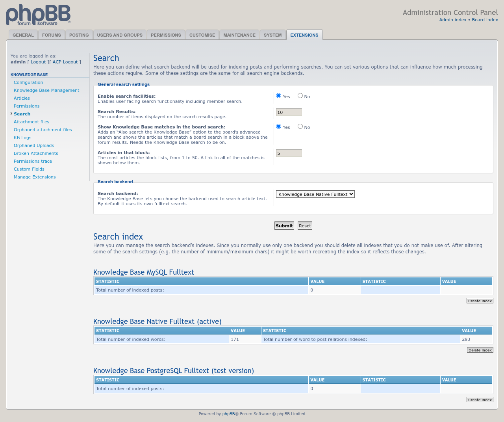

# Knowledge Base screenshots

Taken with Playwright by `phpbb-test-board/screenshots.py` in [phpbb-release-tools](https://github.com/phpbbmodders/phpbb-release-tools) on a throwaway phpBB 3.3 board (prosilver, SQLite) filled with example articles and forum questions, as an administrator. The flat article index is the default; the category tree needs **Hierarchical category browsing** switched on under **Extensions > Knowledge Base > Configuration**.

A change that alters a page shown here means retaking them, with the extension's own entry in that script:

```bash
phpbb-release-tools/phpbb-test-board/screenshots.py path/to/knowledgebase -o path/to/knowledgebase/docs/images/screenshots --seed path/to/seed-forum/bin/seed-standard-fixtures.php
```

The two ACP pages are taken in full, so a setting further down the page is not cut off.

## The flat article index

Every article in one list, with a dropdown to narrow it down by category.


## Hierarchical category browsing

The category tree with its subcategories, article counts and the last article of each.


## An article

The article with its status, details, a copyable link and BBCode, and the tab that reads "Reading Article #1".


## Manage your articles

A member's own articles and drafts.


## Recent changes

The **Recent changes** tab: the live articles, newest first, with a **New** or **Updated** badge, the category, the author and when the article last changed. Under the heading are the RSS and Atom feeds of the same list. A browser or feed reader also finds them from the page header, and the ACP says which formats are offered.



## Add an article

The form for a new article.


## The approval queue

The Administration tab: new articles and revisions waiting for review, with the actions available to a moderator.


## Search

Results of a search on the Knowledge Base's own search page.


## ACP configuration

**Extensions > Knowledge Base > Configuration**, the whole page: the announcement and changelog forums, hierarchical browsing, the alternative stylesheet, the **Recent changes feed** (RSS, Atom or both), the number of articles per page, the description length and the sorting order, then the attachment settings, the review teams and the contact group.


## Knowledge Base articles in the board's search

A search in phpBB's own search for `backup`. The **Knowledge Base (4)** block sits above the forum results and lists the best matches with their category, a snippet with the word marked and a link to all of them; the forum post that asks about backups is the first of the forum results below it. Switch the block off, or set how many articles it lists, in the ACP.


## Also search the Knowledge Base

The advanced search has an **Also search the Knowledge Base** option, ticked by default.



## ACP search settings

**Extensions > Knowledge Base > Search**: under **General search settings**, whether the board search shows the Knowledge Base block and how many articles it lists, beside the results per page for the Knowledge Base's own search; then the search backend and each backend's index.



