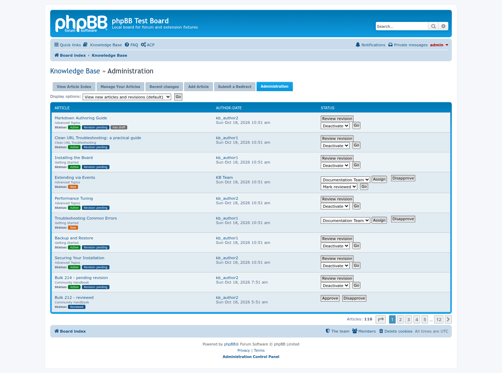
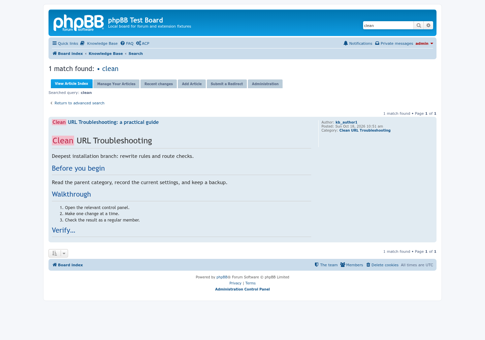

# Knowledge Base update screenshots — 10/18/2026

Change the primary author to an active member or a configured Knowledge Base team.

Colored status badges and draft/revision indicators in the Administration queue.

Rendered Markdown headings and lists in Knowledge Base search excerpts.

