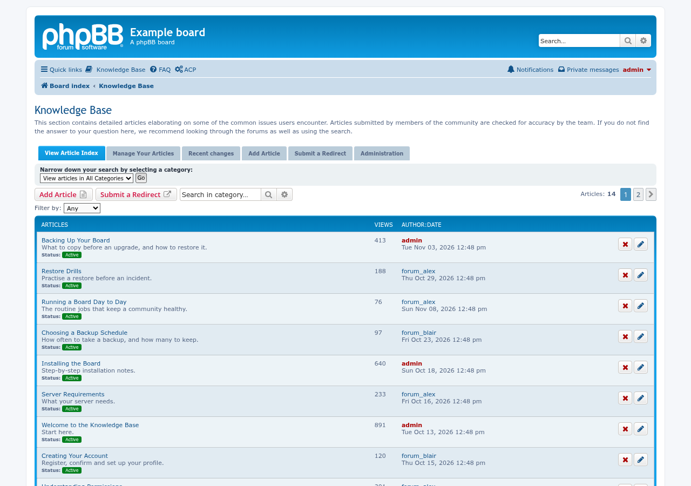
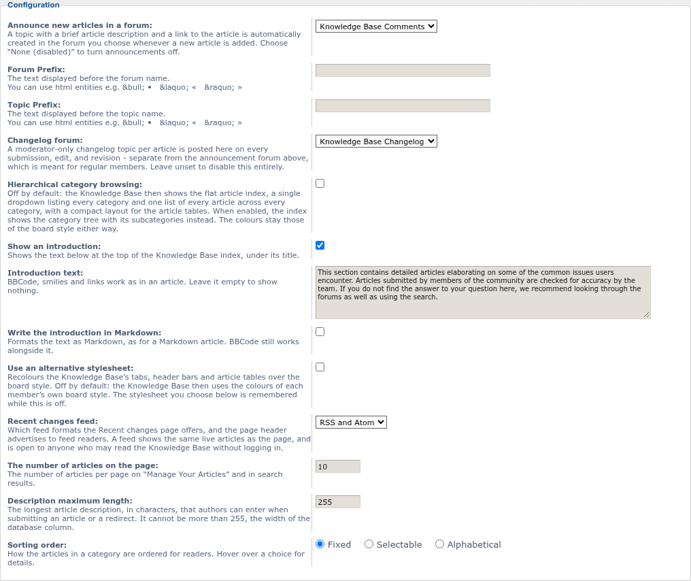

# Knowledge Base update screenshots — 11/12/2026

An optional introduction under the Knowledge Base title on the index, in BBCode or Markdown.

The introduction settings in the ACP configuration: switch it on, write the text, and choose Markdown if you like.

